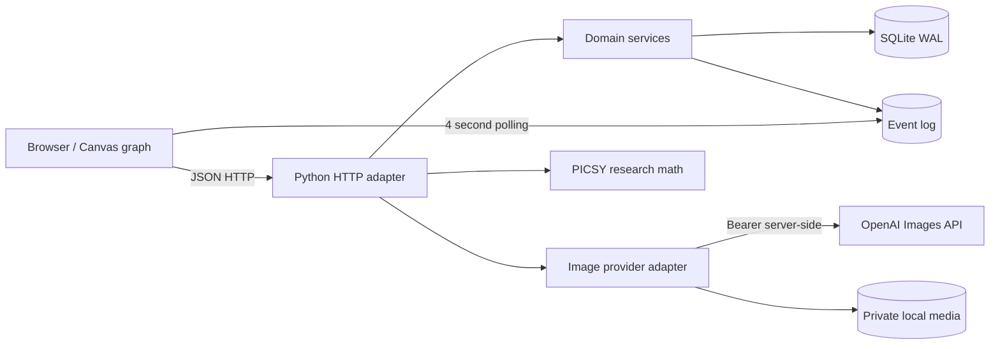

# ZOKUZOKU — みんなの好きが『ゾクゾク』と。

> **つくる → ひろがる → 見つかる → 商品化・共創する**  
> ファン同士でグッズアイデアを生成・継承・共進化させ、思いがけない「欲しいっ！」を発見するサービスの**実行可能なMVP**。

  

**重要:** このリポジトリは**社内実証に向けた研究プロトタイプ**です。外部公開や実際の金銭・ポイント・知的財産権・レベニューシェアを扱う製品ではありません。本人確認、未成年対応、権利者審査、法務、決済連携などは未実装です。**デモユーザーの切替は認証ではありません。** インターネットへ公開しないでください。

## 1. 事業の考え方

「売れる商品は初めから計画できない」。顧客は完成済みの商品を評価できても、自分の想像を超える商品を事前に回答できるとは限りません。そこで生成AIによる個人創作、他者によるリミックス、自由な進化の可視化、購入意思の観測、商品化判断を一つの循環にまとめます。

- **表の体験:** ファンが原案をつくり、枝分かれする系譜マップで他者の創作を見つけ、継承し、好きな作品を応援する。
- **企業向けの価値仮説:** 創作の**結果だけでなくプロセス**（プロンプト、親子関係、選択、支持、購入意思）から未発見の商品案と需要を検証する。
- **裏側の研究:** PICSYを、原作からn次創作への貢献の伝播を捉える数理モデルとして接続する。PICSYの計算結果と実際の売上分配は**別のもの**。
- **丸井グループとの接続:** 権利者連携、グッズ製造・企画・販売、店舗、EC、イベント。エポスポイント・カード等は将来の検証候補であり、現在は未連携。

「まだ知らなかった欲しい」を実際に発見できるかどうか、また利益が増えるかどうかは**未検証の仮説**です。プロンプトが入力されたという事実だけで顧客インサイトが証明されたわけではありません。

## 2. 動く機能と現状の限界

| 機能 | このMVP | 明示的な制約 |
|---|---|---|
| 作品系譜マップ | Canvasで100サンプルを表示、ドラッグ/ズーム、作品選択とランダム移動 | ノード位置は表現用、推薦アルゴリズムではない |
| 100作品 | 架空のオリジナルクラゲグッズをDBに初回投入 | 描画はSVGのサンプルイラストでAI作品ではない |
| 作品投稿 | タイトル・プロンプト・カテゴリ・方向性を保存 | デモユーザー4人、正式な本人認証なし |
| 二次創作 | 親作品IDと派生世代を不変データとして保存 | 複数親マージと公開権利ライセンスは未実装 |
| 実際の画像生成 | OpenAI Images APIで1枚生成（オプトイン） | 要サーバー側APIキー/予算、API接続・課金状況依存 |
| 画像を用いた進化 | 親が生成PNGならImages Edit APIで元画像を参照 | SVGのみの親作品は文章ベースの派生生成 |
| ライブ同期 | 4秒ごとにイベント番号を確認して再読み込み | WebSocket/SSEではない、分散サーバー未対応 |
| いいね | 1ユーザー1作品、トグル | アビューズ/ボット検出は未実装 |
| 応援意思 | 模擬ポイント10/50/100を1ユーザー1作品で保存 | 金銭/エポスポイントの引落・払い戻しなし |
| コメント | 入力制限、保存、閲覧、XSS対策 | 誹謗中傷/権利侵害の審査と通報導線なし |
| インサイト | カテゴリ/雰囲気/応援意向の集計 | ダミー100件と実ユーザーを区別した厳密分析ではない |
| PICSY | 仮想中央銀行法の静的計算と3人の取引サンプル | 現実の残高・会計・金融商品・分配ではない |

## 3. ローカル起動（追加パッケージ不要）

Python 3.11以降をインストールしてください。

```bash
git clone https://github.com/Katsunobu1008/Zokuzoku_test02.git
cd Zokuzoku_test02
python -m app
```

ブラウザで **http://127.0.0.1:8000** を開きます。初回に `data/zokuzoku.sqlite` が作成され、100件の架空サンプル作品が投入されます。Gitで `data/` は無視されます。

### OpenAI画像生成を有効にする

1. OpenAI Platformで発行した**新しい**APIキーを用意します。チャットやissueに貼ったキーは使わず**ローテーション**してください。
2. 環境変数 `OPENAI_API_KEY` を設定してからサーバーを起動します。

macOS/Linux:

```bash
export OPENAI_API_KEY='YOUR_ROTATED_KEY_HERE'
export OPENAI_IMAGE_MODEL='gpt-image-1-mini'
python -m app
```

PowerShell:

```powershell
$env:OPENAI_API_KEY = 'YOUR_ROTATED_KEY_HERE'
$env:OPENAI_IMAGE_MODEL = 'gpt-image-1-mini'
python -m app
```

**APIキーをHTML、ブラウザJavaScript、GitHubリポジトリ、README、ログに貼り付けないでください。** 画像生成はフォーム内の明示的なチェックをONにした場合のみ実行します。回数上限はデフォルトでユーザーあたり1時間に3回、サーバープロセスあたり計50回（再起動でリセットされる暫定制御）。さらに**OpenAI側の利用上限**を設定してください。画像APIのモデル提供状況・権限・価格はOpenAI Platformで確認してください。

### Docker Compose

```bash
docker compose up --build
```

Composeのポートは`127.0.0.1:8000`に限定しており、データは名前付きボリュームへ保存されます。

### テスト

```bash
python -m unittest discover -s tests -v
# or
make check
```

外部APIを呼ばないテストなので、キーは不要です。

## 4. 画面の操作

1. **発見する**: 100個のクラゲアイデアをマップとカードから探索する。拡大、縮小、ランダム移動、人気順で検索。
2. **継承する**: 気になる作品を開き「この作品を継承する」を選ぶ。親IDを持つ新しい作品が登録される。
3. **画像生成（任意）**: 権利確認をしてチェックを入れると、作品登録後にOpenAI Images APIを呼ぶ。エラー時も投稿済みデータは残る。
4. **応援する**: いいね、コメント、仮想ポイントによる応援意思を記録する。
5. **インサイト**: 集計結果を見る。ただしサンプル100件が含まれるため実際の顧客需要ではない。
6. **PICSY LAB**: 原作者A、二次創作者B、ファンCの評価行列Eと変換後E′、貢献度cの変化を確認する。

**別ブラウザ**で開きデモユーザーを切り替えると、数秒の更新間隔で投稿やいいねが他方に表示されます。同一プロセス・同一SQLiteデータベースへの接続を前提とします。

## 5. アーキテクチャ要約



**モジュラーモノリス**を採用。実証段階では開発・運用コストを抑えながら、創作系譜/応援/インサイト/PICSYの境界を保持します。SQLiteは単一ノード向けで、書き込みは `BEGIN IMMEDIATE` によって排他制御します。将来、PostgreSQL・オブジェクトストレージ・ジョブキュー・認証基盤への移行を想定しています。詳細は [`docs/ARCHITECTURE.md`](docs/ARCHITECTURE.md)。

## 6. データモデル

- `users`: 4人のデモアクター。ログイン/身元確認ではない。
- `ideas`: 作品、作者、親作品、生成世代、プロンプト、権利宣言、生成画像パス。
- `likes`: `(idea_id,user_id)` ユニークな反応。
- `pledges`: `(idea_id,user_id)` 単位で保存する**無償の応援意思**。
- `comments`: 作品へのコメント（本文上限400字）。
- `image_jobs`: API連携ジョブ状態（running/complete/failed）。
- `events`: シーケンス番号でマルチブラウザ更新検知。

**作品系譜は単一親DAG**として実装。新規作品は既存作品のみを親とでき、古い作品の親IDは更新されないため、現UIからは循環が生成されません。商品化審査・真正なライセンス・売上分配・画像モデレーションは次段階です。

## 7. API概要

| メソッド | URL | 用途 |
|---|---|---|
| GET | `/health` | 起動確認 |
| GET | `/api/ideas` | 作品/作者/応援数/最終イベント番号 |
| POST | `/api/ideas` | 作品投稿、権利宣言必須 |
| POST | `/api/ideas/{id}/like` | いいねトグル |
| POST | `/api/ideas/{id}/pledge` | 仮想ポイント意思表示 (10/50/100) |
| POST | `/api/ideas/{id}/comment` | コメント投稿 |
| GET | `/api/ideas/{id}/comments` | コメント閲覧 |
| POST | `/api/ideas/{id}/generate` | 本人の作品だけAI画像生成 |
| GET | `/api/events` | 更新シーケンス番号 |
| GET | `/api/insights` | 行動集計 |
| GET | `/api/picsy` | A/B/C評価行列の研究デモ |

書き込みAPIは**デモ限定**で `X-Demo-User: a|b|c|d` を受け付けます。これは攻撃者が自由に変えられるヘッダーであり、認証ではありません。CORSを提供せず同一Origin以外の書き込みを拒否しますが、**これだけでサービスを公開できるわけではありません**。

## 8. 設計判断、根拠、トレードオフ

| 決定 | 理由 | 代償・移行条件 |
|---|---|---|
| Python標準ライブラリのみ | 初期学習/検証で依存サプライチェーンと実行コストを削減 | 本番のHTTP・認証基盤への置換が必要 |
| モジュラーモノリス | 動く価値仮説を先に検証する | 独立スケール/チーム境界は将来 |
| SQLite WAL | セットアップ容易、トランザクションあり | 複数リージョン不可、PITRは別途 |
| ポーリング4秒 | ネットワーク断からの復旧が容易 | 頻繁なGET、真のリアルタイムではない |
| OpenAI API サーバーのみ | キー露出を防ぐ | サーバーに画像生成負荷/予算責務が集中 |
| PICSY独立数理モジュール | 研究と商取引の境界を明確化 | 現金決済とは未接続 |
| 実在IPなし | 著作権・商標・商品化許諾を未取得 | 初期ユーザー体験が限定される |
| 作品の生成系譜を記録 | 新しい商品発見と貢献関係の分析に必須 | 削除要求・作者同意・複合親が今後の課題 |

## 9. 次に実証すべき事業仮説

A. 従来のグッズ閲覧、B. 一人でのAI生成、C. **他者の作品を継承するZokuZoku** を同条件で比較します。

- **顧客価値**: 事前には検討していなかった商品について、価格を提示した後に購入意思を示した比率（最終的には実購入）。
- **共同創作の純増価値**: C−Bの差。単なる画像生成の効果と分離する。
- **事業性**: 原価、製造ロット、著作権料、画像生成費、運営費、既存商品の売上減少を含む案件別**増分利益**。
- **継続性**: D7/D30継続率、1人あたりのリミックス比率、派生経路の多様性。
- **需要予測**: 事前予約の実購入移行率、販売数量予測誤差、在庫消化率。

**現行の100件は架空サンプルです。効果測定の母集団として使わないこと。** 詳しい測定設計は [`docs/REQUIREMENTS.md`](docs/REQUIREMENTS.md)。

## 10. 安全・権利・法務と公開前ゲート

1. **APIキーはサーバー環境変数のみ**。公開済み・チャット共有済みの鍵はローテーション。GitHub Secret Scanningと請求上限設定を推奨。
2. 実在IPやブランドの無許諾アップロードは禁止。利用者の「自分の作品です」チェックだけでは法律上の許諾を代替できない。
3. **本番で必須**: OIDC認証、セッション/CSRF、防御的レート制限、生成画像/プロンプトの審査、削除・通報、監査ログ、権利証跡、個人情報の保存期間/同意、事業者向け契約、賠償/責任分界。
4. **金銭/投資/ポイント:** 日本の資金決済法、金融商品取引法、景品表示法、資金移動・前払式支払手段等の該当性を専門家と調べ、ライセンス/許可/契約が整うまで実装しない。`PICSY` の数値は金銭や配当請求権ではない。
5. このサーバーを公网に直接公開しない。リバースプロキシ、TLS、WAF、認証、監査、運用監視などを整備するまでローカルのみ。

## 11. ディレクトリ構成

```text
app/
  server.py           HTTP routing, request validation, rate limits, API adapter
  store.py            SQLite schema, seed, transactional domain operations
  image_provider.py   OpenAI Images generate/edit integration, server-only key
  picsy.py            Independent PICSY virtual bank math, research only
web/
  index.html          UI and accessibility structure
  styles.css          Responsive design
  app.js              Canvas map, branching UX, poll sync, API client
tests/                Domain and numerical invariants
docs/
  REQUIREMENTS.md     Detailed stories, acceptance criteria, rollout gates
  ARCHITECTURE.md     ADRs, context map, data design, security and scaling
  PICSY.md            Mathematical interpretation and economic boundary
  OPERATIONS.md       Runbook, observability, recovery, budget
.github/workflows/ci.yml
```

## 12. 参考資料・出典

- 提供された企画書：**ZokuZoku 新規事業企画書** 原文尊重版/整理版とクラゲグッズ100世代進化マップ（ユーザーが作成・提供）。
- 提供された **『PICSY のモデル』第4章**：評価行列、仮想中央銀行、式(4.60)〜(4.65)。
- 提供された『データ指向アプリケーション』『ビヨンドソフトウェアアーキテクチャ』『ソフトウェア設計のトレードオフと誤り』『ソフトウェアアーキテクチャの基礎』（それぞれ提供された範囲）：データ整合性、変更容易性、ADR、適切な複雑性を選ぶ設計上の参考。文章の転載はしていない。
- OpenAI API: [Image generation guide](https://platform.openai.com/docs/guides/image-generation), [Images API reference](https://platform.openai.com/docs/api-reference/images)。

---

**ライセンス:** 実験コードはMIT。第三者IP、商標、ユーザー生成画像の利用権が付与されることはありません。既存の商品画像・ファンアートの権利は別途確認してください。
