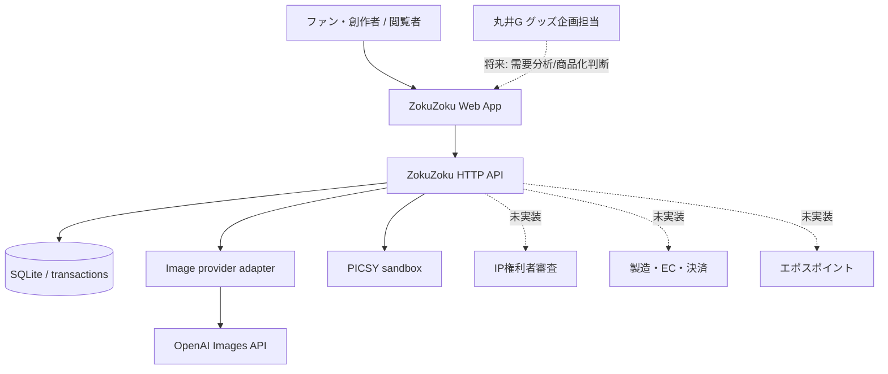
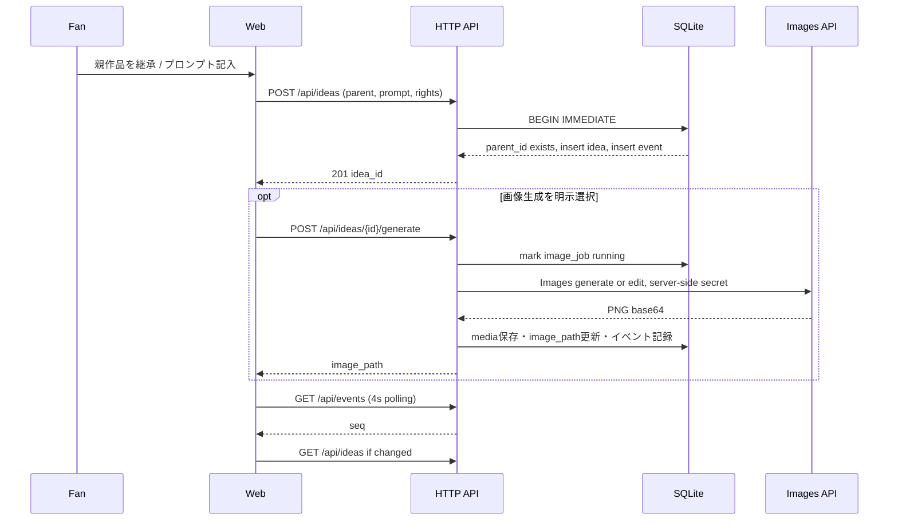

# ZOKUZOKU — システムアーキテクチャ仕様 (MVP → Production)

## 0. 前提、アーキテクチャ特性と意思決定記録

**プロダクト目標:** 大量の派生作品の発見と共創、未充足需要の観測、商品化への橋渡し。目標数は将来数万人規模、実装現状は100件の初期サンプル・数人の試験参加。根拠のないスケーラビリティ主張は行わない。

**特性の優先順位**: (1)秘密/権利の保護 (2)投稿と系譜の整合性 (3)変更可能性 (4)操作性/アクセシビリティ (5)画像生成コスト制御 (6)パフォーマンス (7)水平拡張性。研究段階は可用性SLAなし。

| ADR | 決定 | ステータス | 廃止条件 |
|---|---|---|---|
| ADR-001 | 1プロセスのモジュラーモノリス、HTTP JSON API | 採用 | 境界の独立デプロイが必要な場合 |
| ADR-002 | SQLite WAL、トランザクション内でデータと更新イベント記録 | 採用 | 複数ノード、複数リージョン、オンラインスキーマ変更が必要な場合 |
| ADR-003 | 4秒ポーリング | 採用 | 同時接続数・反応速度要件によりSSE/WebSocket移行 |
| ADR-004 | 画像生成はサーバーのプロバイダーアダプター | 採用 | 複数事業者・大量非同期化が必要な場合 |
| ADR-005 | 決済と研究用PICSYのストレージを完全に分離 | 採用 | 実サービスの法的認可/経済システム検証後も強い分離を維持 |
| ADR-006 | AI未生成でも作品投稿できる | 採用 | 生成費負担をユーザーに強いない |
| ADR-007 | 外部IPは許諾ワークフロー整備まで不可 | 採用 | 権利者と利用範囲、二次利用、対価、同意が契約化されたとき |

## 1. C4：コンテキスト

## 2. モジュールと依存方向

- `web`: 表示・Canvasマップ・UI状態・フォーム・定期ポーリング。直接DBやAPIキーへアクセスしない。
- `app/server`: HTTP入力の長さ/形式/権限の暫定検査・レスポンス・同一Origin制限。
- `app/store`: 作品と親子関係、作者、応援、コメント、イベント、画像状態の唯一の更新窓口。
- `app/image_provider`: 外部APIのタイムアウト・サイズ境界・エラー変換。署名鍵は参照しない。
- `app/picsy`: 純関数の数理研究コンテキスト。画像生成やユーザーDBには依存しない。

境界を保つ理由：PICSYの数理実験が、商品販売時の収益計算やユーザーの金銭的資産の保存に無意識に混入するのを防ぐ。支持の観測と対価の支払いは別ドメイン。

## 3. 主要ユースケース：創作

故障時：POSTに成功して生成が失敗してもアイデアは残る（ビジネス事実をロールバックしない）。画像APIレスポンスはファイルサイズを制限し、ローカルファイルへ一時書き込み後に置換。画像生成中にサーバーが落ちると`running`が残り得るため、再起動後のタイムアウト回復/バックグラウンドジョブは次段階で必要。

## 4. 整合性・冪等性・並行性

- FK制約・ユニークキー（1ユーザー/1作品のLIKEとpledge）、SQLiteの`BEGIN IMMEDIATE`で二重書き込み競合を防ぐ。
- `idea_id`はUUID派生値、親IDは更新禁止。既存親だけを登録するためDAGの非循環性を維持。
- イベントは変更と同じDBトランザクションで追加する。イベント通知の欠損後にも最新`seq`で追いつける。
- **未完事項:** API書き込みの`Idempotency-Key`未対応。ネットワークの再試行で作品やコメントが二重投稿し得る。実売・ポイント接続前に必須。
- **未完事項:** データ削除と派生作品の扱い。原作品の権利失効・撤回時の子孫の再審査が必要。

## 5. セキュリティモデルと脅威

| 攻撃・故障 | MVPの措置 | 公開前に必須の対策 |
|---|---|---|
| APIキー露出 | サーバーの環境変数、Git無視、クライアントへ返さない | Secret manager、ローテーション、資格情報スキャン、監査 |
| 他人の投稿改ざん | 画像生成はauthor_idとデモID一致 | OIDC + セッション、リソース単位の認可、CSRF |
| 偽のデモユーザー | **防げない**: X-Demo-Userは誰でも指定可能 | デモ廃止、OIDC認証、レート制限主体の統一 |
| プロンプトによるXSS | フロント表示前にHTMLエスケープ、CSP、no-sniff | サーバー側サニタイザー、HTML禁止、CSP維持 |
| 大量画像生成費 | 明示チェック、ユーザー/サーバー上限、HTTPタイムアウト | 永続クォータ、日次予算、ジョブキュー、請求アラート |
| IP侵害 | `original` 申告以外は拒否 | 事前審査、ライセンス台帳、通報、監査と異議申立て |
| ボット応援/架空需要 | 1ユーザー1作品DB制約 | Bot対策、信頼スコア、購買証憑、耐Sybil設計 |
| PICSYの資金流出 | PICSYは純計算、**金銭機能ゼロ** | 法務/会計監査、複式台帳、権限分離、第三者監査 |
| ローカルデータ消失 | SQLiteファイルの永続化 | WAL対応バックアップ、PITR、DR訓練 |

## 6. 移行アーキテクチャ案

### Phase 1（現在）
単一Pythonプロセス＋SQLite＋サーバーローカル画像。1台のローカルPCでユーザーテスト。

### Phase 2（クローズドベータ）
- React/Vite等の型付きフロントエンド、アクセシビリティ自動検査。
- PostgreSQL移行とAlchemy/Alembic系のmigration管理、行レベル認可、監査イベント。
- 画像はS3等のオブジェクトストレージ、署名URLと原本保持ポリシー、マルウェア/内容スキャン。
- OIDC認証（魔法リンク等でもよいがセッション管理必須）。招待・IP権利同意・通報導線。
- バックグラウンドワーカー＋キュー＋ジョブIdempotency、予算メーター、結果再配信。
- SSEまたはWebSocketの更新フィード、イベントoutbox。

### Phase 3（商品化）
- Productization：IP審査、商品仕様、原価、MOQ、価格、予約・キャンセル、製造/物流イベント。
- Purchase：実際の決済トランザクションは認可済み決済事業者に委譲、内部複式会計台帳を別境界に。
- Research & Growth：A/B/C実験、見積/予約/売上から需要予測と因果推定、品番/商品化案件単位の損益。
- Royalty：原作と派生創作の契約範囲、分配台帳/税務処理、異議申立て/保留金。
- PICSY：数学的妥当性、経済的インセンティブ、耐Sybil、法的性質を検証してから限定的統合。

## 7. 品質目標（**将来の目標値**）

- 作品カード初期描画 p95 2秒以内、系譜1万ノードのユーザー操作60fpsを目標（要WebGL/LOD測定）。
- 作品・いいね操作API p95 300ms以内（画像生成API除外）。
- データの参照整合性100%、同一の応援意思二重記帳0件。
- コンテンツ権利審査/通報の暫定対処時間を契約と運営体制に応じ設定。
- 画像生成の1ユーザー1日上限と月次運営予算をサーバーDB/決済と連携し強制。

**重要:** 上記は測定済みSLOではありません。負荷試験を実施していない現状では、性能保証はできません。
